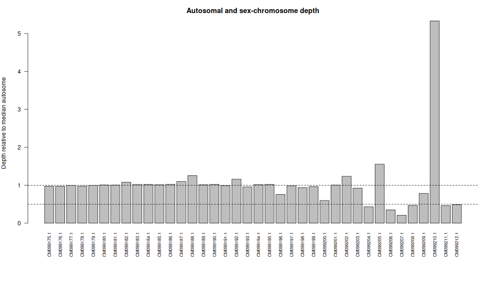

# Sex-Chromosome Dosage in a Selected Animal Nuclear Genome

### Selected Species: Indian peafowl (*Pavo cristatus*)

The Indian peafowl is a bird with a ZZ/ZW sex-determination system. In this system, males normally have two Z chromosomes (ZZ), while females have one Z chromosome and one W chromosome (ZW).

The chromosome-level reference assembly used in this study is GCA_045791835.1. The NCBI sequence report identifies the Z chromosome as `CM099212.1` and the W chromosome as `CM099211.1`.

### Study Question:

Can chromosome-level sequencing coverage be used to infer whether the WGS individual has a ZW-like or ZZ-like sex-chromosome complement?

This activity investigates whether the sex-chromosome dosage of an Indian peafowl individual can be estimated using whole-genome sequencing (WGS) read depth. The mean sequencing depth of the Z chromosome was compared with the median depth of the autosomes. The W chromosome was also examined as additional evidence.

### NCBI Accession Information:

**Reference genome assembly:**

- Species: *Pavo cristatus*
- Assembly accession: `GCA_045791835.1`
- Assembly BioSample: `SAMN43017984`
- Assembly level: Chromosome
- [NCBI Assembly record](https://www.ncbi.nlm.nih.gov/datasets/genome/GCA_045791835.1/)

**Whole-genome sequencing data:**

- BioProject: `PRJNA1143721`
- Experiment: `SRX25597826`
- SRA run: `SRR30128537`
- WGS BioSample: `SAMN43028758`
- Library strategy: WGS
- Library source: GENOMIC
- Library layout: PAIRED
- Library selection: RANDOM
- [NCBI SRA Run record](https://www.ncbi.nlm.nih.gov/sra/SRR30128537)
- [WGS BioSample record](https://www.ncbi.nlm.nih.gov/biosample/SAMN43028758)
- [Assembly BioSample record](https://www.ncbi.nlm.nih.gov/biosample/SAMN43017984)

The WGS BioSample metadata reports the individual as female.

The assembly BioSample (`SAMN43017984`) and WGS BioSample (`SAMN43028758`) are different. Therefore, the sequencing analysis estimates the sex-chromosome complement of the WGS individual, not necessarily the individual used to produce the reference assembly.

### Galaxy Analysis:

Galaxy was used to import the reference genome and WGS reads, assess read quality, map reads, and calculate chromosome-level sequencing coverage.

Galaxy platform: [https://usegalaxy.org](https://usegalaxy.org)

Galaxy workflow/history: https://usegalaxy.org/published/workflow?id=421abc73d2356324

**Exact Galaxy steps:**

1. Created a new Galaxy history for the sex-chromosome dosage analysis.
2. Uploaded the reference genome FASTA file obtained from the NCBI assembly.
3. Imported WGS run `SRR30128537` using the Galaxy tool Faster Download and Extract Reads in FASTQ format from NCBI SRA.
4. Selected `--split-files` to separate the paired-end reads into forward and reverse FASTQ files.
5. Selected the option to dump only biological reads.
6. Ran FastQC on the paired-end sequencing reads to assess read quality.
7. Used BWA-MEM2 to map the paired-end reads against the *Pavo cristatus* reference genome.
   - Selected paired-end reads.
   - Used the forward and reverse read files.
   - Selected the uploaded reference genome.
   - Generated BAM output.
   - Enabled coordinate sorting.
8. Used Samtools index to index the resulting BAM file.
9. Ran Samtools coverage on the mapped BAM file.
   - Minimum mapping quality: 20
   - Minimum base quality: 20
10. Downloaded the coverage output as a tabular file and saved it as `chromosome_coverage.tsv`.

BWA-MEM2 was used because the original BWA-MEM tool encountered server-related errors during execution.

The resulting coverage table contains chromosome identifiers and sequencing coverage information, including `rname` and `meandepth`.

### Chromosome Groups and Identification:

The NCBI sequence report for assembly `GCA_045791835.1` was used to identify the chromosomes and match their accession identifiers with their chromosome names.

**Table 1.** *Chromosome groups and reference sequence identifiers used in the sex-chromosome dosage analysis of Pavo cristatus.*

| Chromosome group | Reference sequence identifiers | Assigned label |
|---|---|---|
| Autosomes | `CM099175.1` through `CM099210.1` | A |
| W chromosome | `CM099211.1` | W |
| Z chromosome | `CM099212.1` | Z |

The 36 autosomes were assigned the label `A` because they serve as the reference group for calculating median autosomal depth.

The Z and W chromosomes were assigned their respective labels because the Indian peafowl follows a ZZ/ZW sex-determination system.

The mitochondrial sequence was excluded because it is not a nuclear chromosome. Unplaced sequences and other non-chromosomal sequences were also not included.

The chromosome labels were saved in `chromosome_groups.csv`.

### Input Files:

The following files were used for the analysis:

- [`chromosome_coverage.tsv`](chromosome_coverage.tsv) – chromosome-level coverage output generated by Samtools coverage.
- [`chromosome_groups.csv`](chromosome_groups.csv) – chromosome accession identifiers and their assigned groups.
- [`sex_depth_analysis.R`](sex_depth_analysis.R) – R script used to calculate relative chromosome depth and infer sex-chromosome dosage.

The coverage table contains the input sequencing-depth values used in the analysis. The `meandepth` column was used for the calculations.

### R Analysis:

The analysis was performed using R in Posit/RStudio. The script calculates the median autosomal depth and the relative depth of the sex chromosomes.

The relative depth was calculated by dividing each chromosome's mean depth by the median mean depth of the autosomes.

**Complete R code:**

```r
cov <- read.delim("chromosome_coverage.tsv", comment.char = "",
                  check.names = FALSE, stringsAsFactors = FALSE)

names(cov)[1] <- "rname" # Accepts the '#rname' header

if (!"meandepth" %in% names(cov)) stop("Missing meandepth column")

key <- read.csv("chromosome_groups.csv", stringsAsFactors = FALSE)

if (!all(c("rname", "group") %in% names(key))) stop("Bad key columns")

key$rname <- trimws(key$rname)
key$group <- toupper(trimws(key$group))

if (anyDuplicated(key$rname)) stop("Repeated rname in key file")

if (!all(key$group %in% c("A", "X", "Y", "Z", "W")))
  stop("Use only A, X, Y, Z or W in the group column")

x <- merge(key, cov[, c("rname", "meandepth")],
           by = "rname", all.x = TRUE, sort = FALSE)

x$meandepth <- suppressWarnings(as.numeric(x$meandepth))

if (anyNA(x$meandepth)) stop("Missing depths: check rname matches")

if (any(x$meandepth < 0)) stop("Negative depth is not valid")

if (sum(x$group == "A") < 5) stop("Label at least 5 autosomes")

if ("X" %in% x$group && "Z" %in% x$group)
  stop("Choose either an XY or a ZW species, not both")

if (sum(x$group == "X") == 1 && !any(x$group == "Z")) {
  target <- "X"
  one_copy <- "XY-like"
  two_copies <- "XX-like"
} else if (sum(x$group == "Z") == 1 && !any(x$group == "X")) {
  target <- "Z"
  one_copy <- "ZW-like"
  two_copies <- "ZZ-like"
} else stop("Label exactly one X or exactly one Z chromosome")

A <- median(x$meandepth[x$group == "A"])

if (!is.finite(A) || A <= 0) stop("No usable autosomal coverage")

x$relative_depth <- x$meandepth / A

ratio <- x$relative_depth[x$group == target]

call <- if (ratio >= 0.80) two_copies else if (ratio <= 0.65)
  one_copy else "Ambiguous"

if (A < 1) call <- "Inconclusive: very low autosomal depth"

partner <- if (target == "X") "Y" else "W"

partner_ratio <- if (partner %in% x$group)
  x$relative_depth[x$group == partner][1] else NA_real_

dir.create("results", showWarnings = FALSE)

write.csv(x, "results/chromosome_relative_depth.csv", row.names = FALSE)

png("results/chromosome_depth.png", width = 1000, height = 580)

par(mar = c(8, 4, 3, 1))

barplot(x$relative_depth, names.arg = x$rname, las = 2,
        ylab = "Depth relative to median autosome",
        main = "Autosomal and sex-chromosome depth",
        cex.names = 0.75)

abline(h = c(0.5, 1.0), lty = 2)

dev.off()

summary <- c(
  paste("Median autosome depth:", round(A, 3)),
  paste(target, "/ A ratio:", round(ratio, 3)),
  paste(partner, "/ A ratio:", round(partner_ratio, 3)),
  paste("Dosage interpretation:", call),
  "Compare with BioSample sex and discuss limitations."
)

writeLines(summary, "results/sex_inference.txt")

cat(paste(summary, collapse = "\n"), "\n")
```

**The script uses the following thresholds:**

- Relative depth of 0.80 or higher: suggests two copies of the target sex chromosome.
- Relative depth of 0.65 or lower: suggests one copy of the target sex chromosome.
- Between 0.65 and 0.80: considered ambiguous.
- Median autosomal depth below 1: considered inconclusive because of very low coverage.

### Results:

**Table 2.** *Summary of chromosome sequencing depth measurements and inferred sex-chromosome complement of the WGS individual of Pavo cristatus.*

| Measurement | Result |
|---|---:|
| Median autosomal depth | 8.643 |
| Z:A relative-depth ratio | 0.488 |
| W:A relative-depth ratio | 0.462 |
| Dosage interpretation | ZW-like |

The Z:A ratio of 0.488 is close to the expected relative depth of 0.5 for a chromosome present in one copy compared with two-copy autosomes.

The W:A ratio of 0.462 is also close to 0.5.

These results support a ZW-like sex-chromosome complement, consistent with a female Indian peafowl.

**The following files were generated by the R script:**

- [`chromosome_relative_depth.csv`](results/chromosome_relative_depth.csv) – relative-depth values for the chromosomes.
- [`chromosome_depth.png`](results/chromosome_depth.png) – bar graph of chromosome depth relative to median autosomal depth.
- [`sex_inference.txt`](results/sex_inference.txt) – text summary of the analysis and dosage interpretation.



**Figure 1.** *Chromosome sequencing depth relative to the median autosomal depth in *Pavo cristatus*. The dashed lines indicate relative-depth values of 0.5 and 1.0. Most autosomes are near 1.0, while the Z and W chromosomes are near 0.5, supporting a ZW-like complement.*

### Questions:

**1. What species did you choose, and what evidence supports a diploid XX/XY or ZZ/ZW system?**

- The selected species was the Indian peafowl (*Pavo cristatus*). It has an established avian ZZ/ZW sex-determination system, in which males normally have ZZ chromosomes and females have ZW chromosomes. The NCBI sequence report identifies the Z and W chromosomes in the selected reference assembly as `CM099212.1` and `CM099211.1`, respectively.

**2. What are your assembly accession, WGS run, and both BioSample accessions? Are the donors the same?**

- The reference assembly accession is `GCA_045791835.1`, with assembly BioSample `SAMN43017984`. The WGS run is `SRR30128537`, with WGS BioSample `SAMN43028758`. The donors are not the same because the assembly and WGS data have different BioSample accessions.

**3. Which sequences were used as autosomes and as X or Z? How did you verify their identities?**

- The 36 autosomes were identified using the NCBI sequence report and correspond to accessions `CM099175.1` through `CM099210.1`. The Z chromosome is `CM099212.1`, and the W chromosome is `CM099211.1`. Their identities were verified using the NCBI sequence report for assembly `GCA_045791835.1`. The mitochondrial sequence was excluded from the analysis.

**4. What are the median autosomal depth, X:A or Z:A ratio, and inferred sex-chromosome complement?**

- The median autosomal depth was 8.643. The Z:A ratio was 0.488, while the W:A ratio was 0.462. Both values are close to 0.5, supporting a ZW-like sex-chromosome complement.

**5. Does your result agree with the recorded sex of the WGS donor, if reported? Explain any discrepancy or uncertainty.**

- Yes. The inferred ZW-like complement agrees with the female sex recorded in the WGS BioSample metadata. However, the result is an estimate based on sequencing depth and may be affected by nonuniform coverage and mapping bias. Some autosomes showed unusually high or low relative depth, so the result should be interpreted with these limitations in mind.

**6. Why is a chromosome-level assembly alone insufficient for a reliable read-depth sex inference?**

- A chromosome-level assembly provides an organized reference genome, but it does not establish the sex-chromosome complement of the individual whose sequencing reads are being analyzed. WGS reads from the individual are needed to calculate chromosome-level sequencing depth and compare the sex chromosomes with the autosomes. Read depth can also be affected by mapping bias, repetitive sequences, coverage differences, and reference assembly limitations. Therefore, both a suitable reference assembly and WGS data from the individual being studied are necessary.

### Limitations:

- **Different donors:** The reference assembly and WGS data came from different BioSamples. The analysis therefore estimates the sex-chromosome complement of the WGS donor, not the assembly donor.
- **Uneven sequencing coverage:** Sequencing depth was not uniform across all autosomes. Some chromosomes had unusually high or low relative depth.
- **Mapping bias:** Differences between the WGS reads and the reference genome may affect how successfully reads map to certain chromosomes.
- **Repetitive and duplicated regions:** Repetitive or duplicated sequences may cause unusually high read depth in some regions.
- **Sex-chromosome structure:** Differences in the degree of differentiation between the Z and W chromosomes may influence mapping and coverage.
- **Reference assembly limitations:** Missing, incomplete, or incorrectly represented regions may affect chromosome-level depth estimates.
- **Read-depth interpretation:** A relative depth near 0.5 supports a single-copy interpretation but does not independently prove the exact karyotype of an individual.

For example, chromosome 36 showed unusually high mean depth relative to the other autosomes, while chromosomes 32 and 33 showed lower depth. These differences may reflect coverage variation or mapping-related factors. The median autosomal depth was used to reduce the influence of extreme values.

### Conclusion:

The chromosome-level read-depth analysis of the Indian peafowl (*Pavo cristatus*) produced a median autosomal depth of 8.643, a Z:A ratio of 0.488, and a W:A ratio of 0.462. The relative depth of both sex chromosomes was close to 0.5, supporting a ZW-like sex-chromosome complement. This result agrees with the female sex recorded in the WGS BioSample metadata. Overall, the analysis demonstrates how chromosome-level sequencing coverage can be used to estimate sex-chromosome dosage, while also showing the importance of considering sample identity, sequencing coverage, and mapping limitations.

### References:

1. National Center for Biotechnology Information (NCBI). NCBI Datasets. https://www.ncbi.nlm.nih.gov/datasets/
2. National Center for Biotechnology Information (NCBI). Sequence Read Archive (SRA). https://www.ncbi.nlm.nih.gov/sra
3. NCBI Assembly record: *Pavo cristatus*, `GCA_045791835.1`. https://www.ncbi.nlm.nih.gov/datasets/genome/GCA_045791835.1/
4. NCBI SRA Run record: `SRR30128537`. https://www.ncbi.nlm.nih.gov/sra/SRR30128537
5. Galaxy Project. Galaxy platform. https://usegalaxy.org
6. Galaxy Training Network. https://training.galaxyproject.org/
7. Samtools. Samtools coverage documentation. https://www.htslib.org/doc/samtools-coverage.html
8. Review on sex chromosome dosage and read-depth approaches. https://pmc.ncbi.nlm.nih.gov/articles/PMC6900093/
